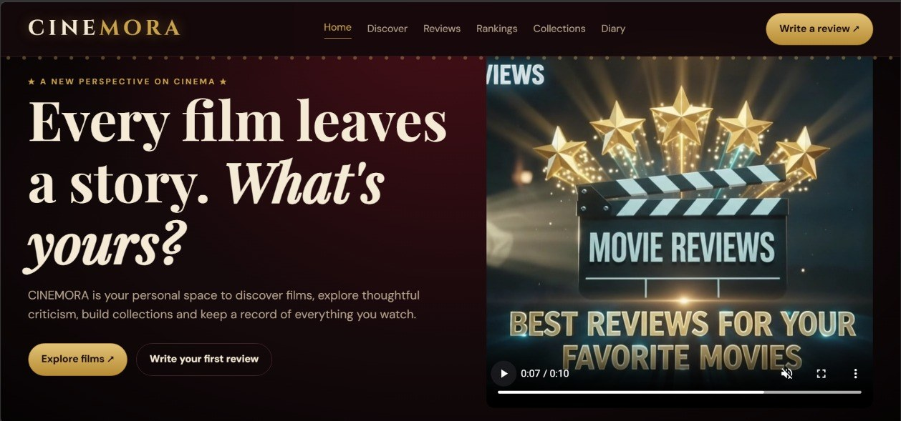
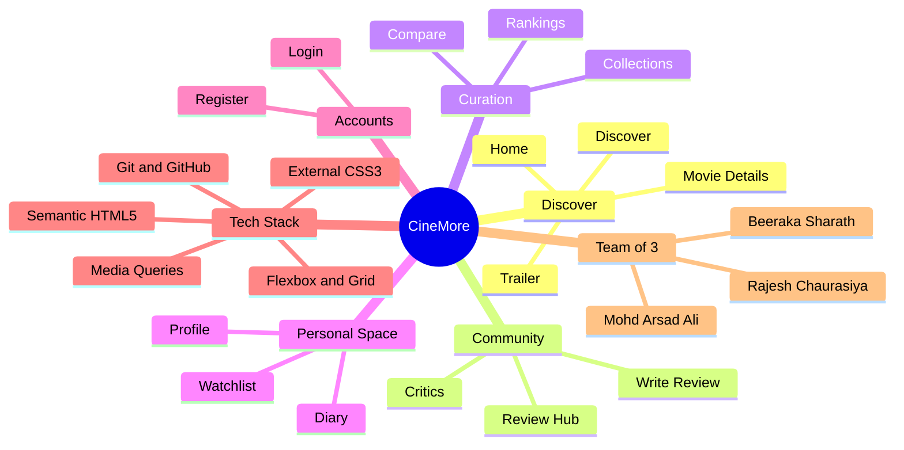
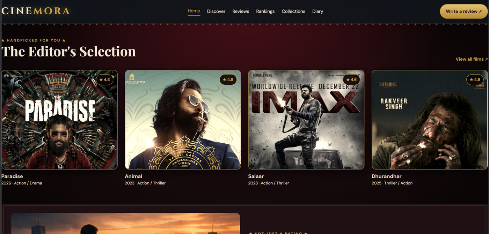
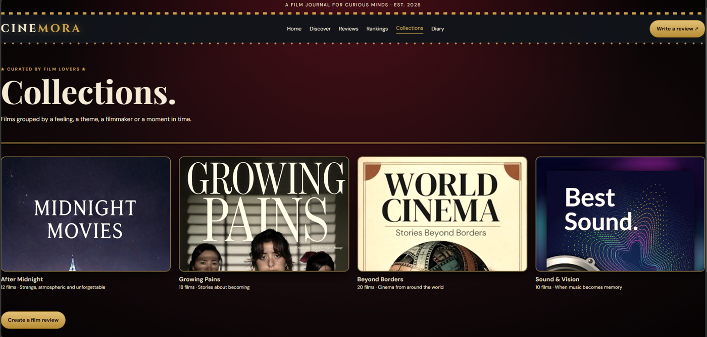
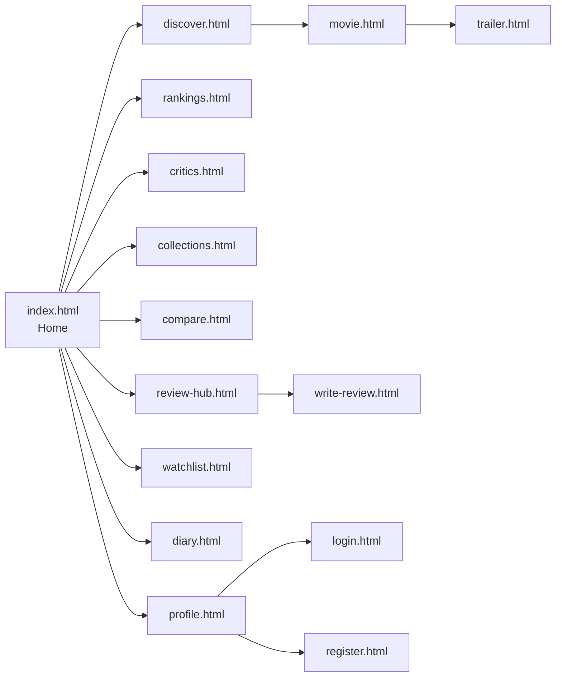
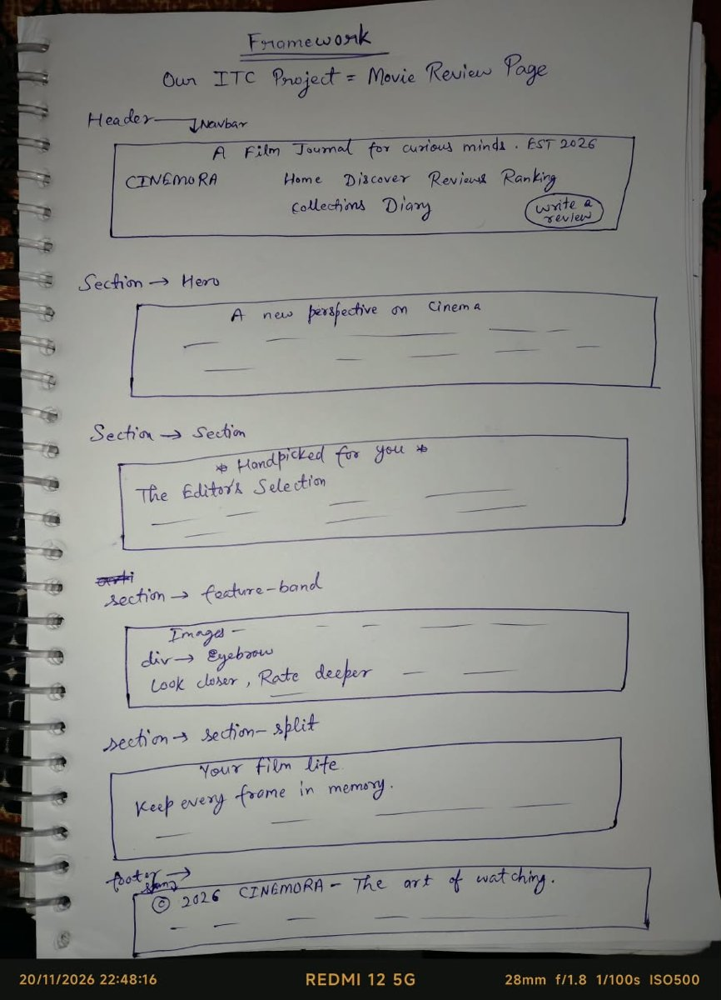

<div align="center">

# 🎬 CineMore

### A multi-page movie review and film discovery website, built with semantic HTML5 and modern CSS3


**Introduction to Computers · Group 5**

[🌐 **Live Demo**](https://sharathbeeraka6-lab.github.io/Movie-Review-Website/) · [Features](#-features) · [Mind Map](#-project-mind-map) · [Quick Start](#-quick-start) · [Team](#-meet-the-team)



</div>

---

## 📖 About the Project

CineMore is a **film journal for curious minds**. It is a single place where movie lovers can discover films, read critic reviews, compare ratings, watch trailers, and keep a personal diary of everything they watch.

The whole site is hand-written with **no frameworks and no libraries**. Every page shares one external stylesheet, which keeps the design consistent and the code easy to maintain.

| Who is it for? | What they get |
|---|---|
| 🎞️ **Movie buffs** | Rankings, curated collections and side-by-side comparisons |
| 🍿 **Casual viewers** | Easy discovery of what to watch next, with trailers |
| ✍️ **Critics and reviewers** | Profiles and a dedicated form to write reviews |
| 📋 **Everyone** | A personal watchlist and watch diary |

---

## ✨ Features

- 🔭 **Discover:** browse the full movie catalogue and open a detailed page for each film
- 🏆 **Rankings:** top-rated films shown as lists and tables
- 🎙️ **Critics:** verified critic profiles with editorial reviews
- 🗂️ **Collections:** film lists grouped by feeling, theme, director or moment in time
- ⚖️ **Compare:** side-by-side rating comparison of two movies
- 📝 **Review Hub and Write Review:** a community feed plus a form for ratings and written reviews
- 🎥 **Trailers:** an embedded trailer showcase
- 📌 **Watchlist and Diary:** save films for later and keep a chronological watch log
- 👤 **Accounts:** login, register and profile pages
- 📱 **Responsive:** works on desktop, tablet and mobile, with no sideways scrolling

---

## 🧠 Project Mind Map



---

## 📸 Screenshots

<table>
  <tr>
    <td align="center" width="50%"><br><b>Home: The Editor's Selection</b><br>Poster cards with rating badges in a responsive grid</td>
    <td align="center" width="50%"><br><b>Collections</b><br>Films grouped by mood, theme and region</td>
  </tr>
</table>

---

## 🗺️ Site Map



---

## 🚀 Quick Start

No installation or build step is needed. It is plain HTML and CSS.

**Option 1: Use the live site**

👉 https://sharathbeeraka6-lab.github.io/Movie-Review-Website/

**Option 2: Run it locally**

```bash
# 1. Clone the repository
git clone https://github.com/sharathbeeraka6-lab/Movie-Review-Website.git

# 2. Open the folder
cd Movie-Review-Website

# 3. Open index.html in any modern browser (double-click it, or run one of these)
start index.html        # Windows
open index.html         # macOS
xdg-open index.html     # Linux
```

You can also click **Code, then Download ZIP** on GitHub, unzip it, and open `index.html`.

---

## 📁 Project Structure

```text
Movie-Review-Website/
├── index.html           # Landing page and featured movies
├── discover.html        # Filter and browse the full catalogue
├── movie.html           # Single movie: synopsis, cast and ratings
├── rankings.html        # Top-rated films and leaderboard
├── critics.html         # Critic profiles and editorial reviews
├── collections.html     # Curated genre and director lists
├── compare.html         # Side-by-side movie comparison
├── review-hub.html      # Community reviews feed
├── write-review.html    # Form to submit a new review
├── watchlist.html       # Saved movies to watch later
├── diary.html           # Personal watch log
├── trailer.html         # Embedded trailer showcase
├── profile.html         # User dashboard
├── login.html           # Sign-in page
├── register.html        # New account page
├── css/
│   └── style.css        # One shared stylesheet for every page
├── images/              # 40+ posters and avatars
├── LICENSE
└── README.md
```

---

## 🎨 Design System

| Element | Choice | Why |
|---|---|---|
| **Colours** | Deep Navy and Slate `#0F172A` `#1E3A8A`, Gold accent `#F59E0B`, White `#FFFFFF` | A cinema-theatre mood with high contrast for text and star ratings |
| **Fonts** | Poppins for headings, Arial and Segoe UI for body text | Clean, readable type on desktop and mobile |
| **Layout** | Flexbox for navbar, footer and badges. Grid for movie cards and collections | Flexible alignment and automatic wrapping on small screens |
| **Imagery** | Curated movie posters and avatars in `images/` | Real artwork makes every page feel like a film site |

### Wireframe

The page layout was sketched by hand before any code was written.

<p align="center">
  
</p>

---

## 🛠️ What We Used

### HTML5

| Feature | Used in | Purpose |
|---|---|---|
| Semantic tags: `header` `nav` `main` `section` `article` `footer` | All pages | Clear structure, accessibility and SEO |
| Headings and paragraphs | `index`, `movie`, `critics` | Titles, synopses, bios and review text |
| Links and images with `alt` text | `discover`, `collections`, `index` | Page navigation and poster display |
| Lists and tables | `rankings`, `compare`, `diary` | Top-10 charts, comparison metrics and watch logs |
| Forms: `form` `input` `select` `textarea` | `write-review`, `login`, `register` | Ratings, reviews and credentials |

### CSS3

| Feature | Where | Purpose |
|---|---|---|
| Class, ID, element and attribute selectors | `css/style.css` | Targets cards, badges, nav links and inputs |
| Box model with `border-radius` | Cards, containers, buttons | Balanced spacing and rounded poster corners |
| Flexbox and CSS Grid | Navbar, hero, discover and rankings | Responsive poster grids |
| Media queries at `768px` and `480px` | `css/style.css` | Switches multi-column layouts to single column on mobile |
| Hover effects and transitions | Posters, links, buttons | Smooth scaling and shadow effects |

### Tools

| Tool | Purpose |
|---|---|
| Visual Studio Code | Writing the HTML and CSS |
| Chrome DevTools | Testing Grid and Flexbox layouts and phone responsiveness |
| Git and GitHub | Branching (`main`, `rajesh`, `leader`), merging and hosting |

---

## ✅ Testing

| Check | Result |
|---|---|
| Desktop view (1920 × 1080) | ✅ Passed |
| Mobile view (375 × 812) | ✅ Passed |
| Pages tested | Home, Discover, Movie Detail, Write Review |
| Horizontal overflow | ✅ None |

---

## 🧩 Challenges and Solutions

| Challenge | Our solution |
|---|---|
| Movie poster cards had uneven heights across rows | Fixed `aspect-ratio` with `object-fit: cover` |
| The navigation bar overflowed on some screens | Flexbox wrapping plus media queries below `768px` |
| Merge conflicts while editing shared files | Separate feature branches (`rajesh`, `leader`) with review before merging into `main` |

---

## 👥 Meet the Team

**Group 5 · 3 members · Introduction to Computers (BCS1009)**

| | Member | Roll No. | Role | Main work |
|:---:|---|---|---|---|
| 🧑‍💼 | **Rajesh Chaurasiya**<br>[@rajesh7651](https://github.com/rajesh7651) | 202610101200013 | **Team Leader**<br>HTML structure | Site map, wireframes, GitHub setup, `index.html`, `movie.html`, `discover.html` |
| 🎨 | **Mohd Arsad Ali**<br>[@mrcurious-coder](https://github.com/mrcurious-coder) | 202610101200014 | **CSS and Layout**<br>Responsive design | `collections.html`, `critics.html`, image assets, testing |
| 🧪 | **Beeraka Sharath**<br>[@sharathbeeraka6-lab](https://github.com/sharathbeeraka6-lab) | 202610101200015 | **Content and QA**<br>Images and testing | `css/style.css`, `rankings.html`, `compare.html`, layout |

### 📅 How we worked

| Week | Milestone | Owner | Status |
|:---:|---|---|:---:|
| 1 | Topic, site map, wireframes and GitHub setup | Rajesh | ✅ |
| 2 | Semantic HTML5 for all pages | Rajesh and Arsad | ✅ |
| 3 | External CSS, Flexbox and Grid, media assets | Arsad and Sharath | ✅ |
| 4 | Cross-browser testing, bug fixes and report | All three | ✅ |

**Instructor:** Ms. Muskan Katiyar

---

## 🔭 Future Scope

- [ ] ⚡ JavaScript live search and filtering on the Discover page
- [ ] ⭐ Dynamic star-rating calculations
- [ ] 💾 `localStorage` to save watchlists and reviews
- [ ] 🌗 Light and dark theme toggle

---

## 📚 References

- [MDN Web Docs: HTML elements](https://developer.mozilla.org/en-US/docs/Web/HTML/Reference/Elements)
- [MDN Web Docs: Flexible box layout](https://developer.mozilla.org/en-US/docs/Web/CSS/Guides/Flexible_box_layout)
- [W3Schools: Responsive web design](https://www.w3schools.com/html/html_responsive.asp)
- [GitHub Docs: Pull requests](https://docs.github.com/en/pull-requests)

---

<div align="center">

⭐ If you like this project, please give it a star.

*Made with ❤️ and a lot of popcorn by Group 5*

</div>
